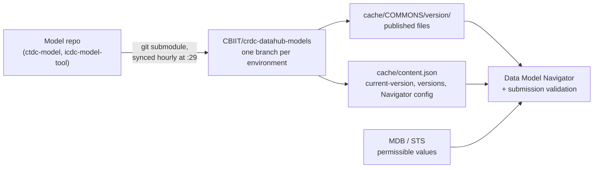

# Data Model Owner's Guide

**Audience:** anyone who owns, edits, or releases a CRDC data commons model that is consumed by the CRDC Submission Portal (also called the CRDC Data Hub).
**Scope:** CRDC-wide. This guide is kept identical in `CBIIT/ctdc-model` and `CBIIT/icdc-model-tool`; update both copies together.
**Verified against:** `CBIIT/crdc-datahub-models`, workflow `.github/workflows/update-model-version.yaml`, as of November 2026.

## How the owner documents fit together

| Document | Answers | Scope |
|---|---|---|
| **Owner's Guide** (this file) | What happens to my model after I merge or tag it? | Same for every commons |
| [Contribution SOP](./contribution-sop.md) | What steps do I follow to make and release a change? | Specific to this repository |
| [Versioning Rulebook](./versioning-rulebook.md) | Is this change a MAJOR, MINOR, or PATCH? | Specific to this repository |

If this guide and the Data Hub's workflow ever disagree, the workflow wins. The workflow is the system; this guide describes it.

## 1. The pipeline at a glance



1. Each commons model repository is a **git submodule** of `CBIIT/crdc-datahub-models`.
2. That repository has one branch per Submission Portal environment: `dev`, `dev2`, `qa`, `qa2`, `stage`, `prod`.
3. A GitHub Action runs **every hour at minute 29**. For each environment branch it moves the submodule to the right commit of your repo, copies your files into a version folder, and updates `cache/content.json`.
4. The Portal reads that branch: the version folder supplies the model and Navigator files, and `content.json` supplies the version list and Navigator settings.
5. Permissible values used during validation come from **MDB** (served by STS), not directly from your YAML. See Section 6.

Nothing in this pipeline is manual. You never create folders or edit files in `crdc-datahub-models` to release a model.

## 2. Which commit each environment sees

| Environments | What the sync uses | Where that is configured |
|---|---|---|
| `dev`, `dev2`, `qa`, `qa2` | The **head of your pre-release branch** | The `branch =` line for your submodule in `.gitmodules` **on each environment branch** of `crdc-datahub-models`. Today both CTDC and ICDC are set to `develop` |
| `stage`, `prod` | Your **highest release tag** | Hard-coded in the workflow |

### How "highest release tag" is chosen

The workflow runs, in your repository:

```bash
git tag -l "[0-9]*.[0-9]*.[0-9]*" | sort -V | tail -n 1
```

What that means in practice:

- **Tags must start with a digit.** `2.1.0` counts. `v2.1.0` and `v.2.1.0` are ignored entirely.
- **The highest version number wins, not the newest tag.** If you tag `1.4.1` after `2.0.0`, stage and prod stay on `2.0.0`.
- **Never put a suffix on a tag at or above your current release.** The pattern matches `4.1.1-hotfix`, and `sort -V` ranks it *above* `4.1.1`, so it would become the production release. Suffixed tags are only harmless when their number is lower than the current release.
- **Branch names do not matter for stage and prod.** Only the tag does. The tag should still point at a commit on your release branch so history stays readable.

## 3. How the version number is determined

The version you see in the Portal is **read from your YAML, not from the tag name**:

- The workflow takes the first file in your commons' `model-files` list (in `content.json`) that has a line starting with `Version:`.
- It strips `Version:`, any `v` or `V`, and every character that is not a digit or a dot. `Version: v4.1.1` and `Version: 4.1.1` both become `4.1.1`.
- That number names the folder (`cache/CTDC/4.1.1/`) and is written to `current-version`.

The tag decides **which commit** stage and prod use. The YAML decides **what that commit is called**. Keep them identical so humans can trust either one.

## 4. What happens when the sync runs

Each hourly run compares the YAML version against `current-version` in that environment's `content.json`:

| Situation | What the workflow does |
|---|---|
| **YAML version is new** | Creates `cache/<COMMONS>/<version>/`, first **copies the previous version's folder into it**, then copies your files over the top. Sets `current-version` and adds the number to the `versions` list |
| **YAML version unchanged, files changed** | **Overwrites the existing version folder in place.** No new entry, no record that it changed |
| **Nothing changed** | Nothing |

Three consequences every owner needs to know:

1. **A change without a version bump rewrites a published version.** If a commit lands on `develop` without a bump, the version currently shown in the lower tiers silently changes content. If a tag points at a commit whose YAML version was not bumped, the version on stage and prod is rewritten. Bump the version for every release, and never move or recreate an existing tag.
2. **A version that is bumped on `develop` but never tagged exists only in the lower tiers.** It shows up in the dev and QA version lists and never reaches stage or prod. CTDC `1.23.0`, `2.1.1`, and `3.9.1` are examples: each has release notes, but none was ever tagged, so production users never saw them as versions. If that happens, either tag the version or say in the release notes which later version shipped its content.
3. **`current-version` follows the YAML even downward.** If `develop` is reset to an older version number, the lower tiers will report the older number as current.

## 5. What gets published

On every run, the workflow copies **everything** under these two folders of your repository, flattened into one version folder:

- `model-desc/`
- `model-navigator-resources/` (if your repository has one)

Rules that follow from this:

- **Only put files there that the Portal should serve:** the model YAML, and the Navigator files named in `content.json` (see Section 7). Scripts, spreadsheets, logs, and test files placed there are published alongside the model.
- **Files never leave a version folder once published.** Because each new version starts as a copy of the previous one, a file that was published once is carried into every later version, even after you delete it from your repository. Removing it from the cache requires a request to the Data Hub team.
- **Filenames must be unique across both folders**, because they land in the same flat folder.

## 6. Where permissible values come from

During submission validation the Portal asks **MDB** (through the STS API) for each property's permissible values, keyed by **model, version, and property**. MDB decides as follows:

| Property state in your YAML | What validates submissions |
|---|---|
| Bound to a caDSR CDE (`Term:` with a live `Code:`) whose value domain is an enumerated list | **The CDE's permissible values.** Any `Enum:` block on the property is ignored for validation, though the Navigator still displays it |
| Bound to a CDE whose permissible values are URL placeholders (external vocabularies such as ICD-O) or that has no enumerated values | The model's own `Enum:` if present; otherwise only the `Type:` |
| No live `Code:` | The model's `Enum:` if present; otherwise only the `Type:` |
| `Code: 'TBD'` | Nothing usable. MDB cannot resolve it. Never release a `TBD` code |

This is why a change to a property's CDE binding can change what validates even when no `Enum:` line moves, and why an `Enum:` edit on a CDE-bound property can be documentation only. The [Versioning Rulebook](./versioning-rulebook.md) turns this into classification rules.

## 7. Navigator configuration belongs to the Data Hub

How your model appears in the Data Model Navigator (filter facets, PDF settings, list delimiter, and which files are the README, release notes, example files, and logo) is set in **`cache/content.json` in `crdc-datahub-models`**, maintained by the Data Hub team. Editing a `content.json` in your own repository has no effect. To change a setting, open a request with the Data Hub team.

The Navigator file names currently configured:

| Setting | CTDC | ICDC |
|---|---|---|
| `model-files` | `ctdc_model_file.yaml`, `ctdc_model_properties_file.yaml` | `icdc-model.yml`, `icdc-model-props.yml` |
| `release-notes` | `version-history.md` | `version.md` |
| `readme-file` | `README.md` | `Data_Model_Navigator_README.md` |
| `loading-file` | `CTDC_Example_Files.zip` | `ICDC_Example_Files.zip` |
| `model-navigator-logo` | `logo.png` | `navigator-icon.svg` |
| `list-delimiter` | default (pipe) | `*` |

Renaming any of these files in your repository breaks the Navigator until the Data Hub updates `content.json`.

## 8. Versioning in one paragraph

Versions follow Semantic Versioning (`MAJOR.MINOR.PATCH`) and describe **the effect of a change on other people**, not the intent behind it. MAJOR: a file that validated against the previous version could now fail, or a consumer (application, loader, ETL, partner) needs code changes. MINOR: the accepted schema grew or loosened. PATCH: nothing that validates or consumes the model behaves differently. Bump once per release, using the most severe change in it. The full rules, including CDE binding changes, live in the [Versioning Rulebook](./versioning-rulebook.md).

## 9. Verifying a release

Allow up to an hour after the merge or tag for the next sync run, then check each environment branch:

```bash
# Replace CTDC with ICDC as needed
for env in dev qa stage prod; do
  printf "%-6s " "$env"
  curl -s "https://raw.githubusercontent.com/CBIIT/crdc-datahub-models/$env/cache/content.json" \
    | jq -r '.CTDC."current-version"'
done
```

Expected results:

- After merging a version bump to `develop`: `dev` and `qa` show the new number; `stage` and `prod` do not.
- After pushing the release tag: `stage` and `prod` show the new number.

Then open the Data Model Navigator in each environment and spot-check a changed property.

## 10. Pitfalls checklist

- [ ] The YAML `Version:` was bumped for this release, and matches the tag exactly
- [ ] The tag starts with a digit, has no suffix, and is higher than every existing release tag
- [ ] No existing tag was moved, deleted, or recreated
- [ ] Nothing new was added under `model-desc/` or `model-navigator-resources/` except model and Navigator files
- [ ] No property carries `Code: 'TBD'`
- [ ] Release notes exist for the version, in the file named by `release-notes`
- [ ] `content.json` on `stage` and `prod` shows the new version

## 11. Getting help

- Questions about this pipeline, Navigator settings, or cleaning a published version folder: the CRDC Data Hub team.
- Questions about this commons' model or release process: the commons' data model owner, or raise it in the team channel named in the [Contribution SOP](./contribution-sop.md).
