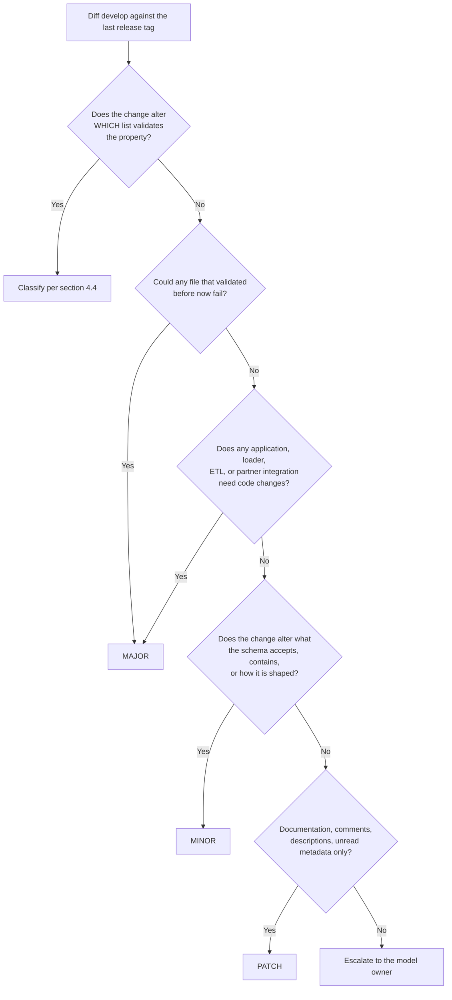

# ICDC Data Model Versioning Rulebook

**Applies to:** `CBIIT/icdc-model-tool`: `model-desc/icdc-model.yml`, `model-desc/icdc-model-props.yml`, and `model-desc/version.md`
**Scheme:** Semantic Versioning 2.0.0 (`MAJOR.MINOR.PATCH`)
**Status:** Proposed. Published for team review; the conventions in Appendix C need explicit ratification.
**Companion documents:** [Owner's Guide](./owner-guide.md) (how the Submission Portal consumes the model), [Contribution SOP](./contribution-sop.md) (the steps), and [MDF Property Playbook](./mdf-property-playbook.md) (property syntax). This Rulebook is the single authority on how to classify a change; the other two documents point here rather than restating it.

---

## 0. One-page cheat sheet

| Change | Bump | Why |
|---|---|---|
| Add a new node | **MINOR** | Nothing that validated before stops validating |
| Remove a node | **MAJOR** | Orphans previously submitted records |
| Add an optional property (`Req: 'No'` or `Preferred`) | **MINOR** | Existing files still pass |
| Add a **required** property (`Req: 'Yes'`) | **MAJOR** | Existing files now fail: they lack the column |
| Remove a property (required or not) | **MAJOR** | Submitted data has nowhere to land |
| Rename a property, node, or relationship | **MAJOR** | A rename is a remove plus an add |
| Loosen `Req` (`'Yes'` to `'No'` or `Preferred`) | **MINOR** | Loosening a constraint |
| Tighten `Req` (`'No'` or `Preferred` to `'Yes'`) | **MAJOR** | Tightening a constraint |
| Change `Type`: any change, including `string` to a list, adding or changing `units`, or "fixing" it | **MAJOR** | Values cast, store, and query differently |
| `Enum:` value added | **MINOR** | Vocabulary expands; old values still valid |
| `Enum:` value removed, commented out, or respelled | **MAJOR** | Previously valid data now fails validation |
| `Type:` replaced by an `Enum:` (literal or reference) | **MAJOR**, or **MINOR** with the coverage check | Narrows from free text to a list; see §4.4 |
| `Enum:` replaced by `Type: string` | **MINOR** | Relaxes to free text |
| `Enum:` reference swapped, or moved to a later caDSR CDE version | **MAJOR**, or **MINOR** with the coverage check | A different value set, or one that may have lost values |
| Add `useNullCDE: Yes` to a property with a value list | **MINOR** | Adds null values |
| Remove `useNullCDE` from a property with a value list | **MAJOR** | Removes accepted values |
| `Term:` added, removed, or re-coded | **MINOR** | Meaning metadata; no validation effect. **MAJOR** if it redefines the property |
| Loosen a relationship multiplicity | **MINOR** | Loosening |
| Tighten a relationship multiplicity | **MAJOR** | Tightening |
| Remove a `Mul:` declaration | **MINOR** | Falls back to the `many_to_many` default, always a loosening |
| Add a `Mul:` where there was none | **MAJOR**, unless it is `many_to_many` | Narrows from the permissive default |
| Add a relationship | **MINOR** | Additive |
| Remove a relationship | **MAJOR** | Breaks graph traversal and loaded data |
| Edit `Desc`, fix a typo, add a comment, change `Tags` no system reads | **PATCH** | No effect on validation or consumers |

**The one-sentence test:** *Would a file that validated against the previous version still validate against this one, and would every consumer still work unchanged?* Two yeses and it is not a MAJOR.

---

## 1. What a version number actually promises

A version number is not a changelog and not a build counter. It is a **promise about compatibility**, aimed at people who are not in the room when the change is made.

The model is a contract with two signatories:

1. **The submitter contract.** A study prepares TSV or Excel files against the model. If the CRDC Submission Portal validates those files against version 2.4.0 and they pass, then 2.5.0 must not make them fail. If they *would* fail, the version must be 3.0.0: the leading digit is the signal that says *"stop, re-check your files before you resubmit."*
2. **The consumer contract.** The ICDC web application, the graph database loader, ETL and harmonization scripts, the Data Model Navigator, and any partner reading ICDC data assume properties keep their names, types, and value sets. If code that worked against one version breaks against the next, that is also a MAJOR.

**Classify against whichever contract breaks first.** A change that is harmless to submitters but breaks the application is still a MAJOR.

That is why "we only fixed a mistake" is never, by itself, a reason to call something a PATCH. The version describes *the effect of the change on other people*, not the intent behind it and not how much work it took.

### 1.1 Which list actually validates: read this before classifying anything

The Submission Portal asks **MDB** (through STS) for each property's permissible values by **model, model version, and property**. Since EDPs went live in early September 2026, MDB answers from `Type:` and `Enum:` only:

| Property state | What validates |
|---|---|
| `Enum:` with literal values | That list |
| `Enum:` with one reference to a caDSR CDE or a CRDC EDP | That value set, at the referenced version |
| `useNullCDE: Yes` in the property's caDSR `Term:` entry | Adds the standard null values to either list above |
| `Type:` (`string`, `integer`, `number`, a pattern) | No list: any value of that type |

**`Term:` is never examined for values.** It records meaning. Before September 2026 the Portal did use a `Term:` CDE's values, so properties written then with a CDE in `Term:` and `Type: string` silently became free text when EDPs launched. That was a platform change, not a model release, and it is the largest open risk in models of that era (Appendix B).

Two consequences shape the rest of this document:

- **Every `Enum:` validates.** There is no longer an "inert" display-only `Enum:`, so every value removal is a MAJOR-class change.
- **A released version's values are fixed by its references.** MDB resolves by model version and by the referenced CDE or EDP version. caDSR can still add values to a CDE without a new version; those reach submitters only after the next model release (Owner's Guide, Section 6.2).

### 1.2 The most common mistake

Version numbers move **per release**, not per commit, per ticket, or per feature branch. Nine commits that add three properties, correct two CDE codes, and fix a typo produce **one** bump, set by the most severe change in the set. The Contribution SOP describes when in the cycle the bump is applied.

---

## 2. Where the version lives, and what "released" means

| Location | Format | Who reads it |
|---|---|---|
| `model-desc/icdc-model.yml` `Version:` line | `Version: v2.2.0` (repository convention; the Portal strips a leading `v`) | **The Submission Portal: this is the number it displays and the folder it publishes to** |
| Git tag on `master` | `2.2.0`: digits only, no `v`, no suffix | The Data Hub sync, which publishes the highest tag to Stage and Prod |
| GitHub Release | `2.2.0` plus notes | People only. The Portal does not read Releases |
| `model-desc/version.md` | an entry for `2.2.0` | End users, in the Navigator's version history |
| `cache/content.json` on the `stage` and `prod` branches of `CBIIT/crdc-datahub-models` | `"current-version": "2.2.0"` | Confirmation that propagation worked |

**A version is released only when all five agree.** Until `content.json` on `prod` shows the new number, do not tell stakeholders the version is live.

A version number that appears only in the lower tiers (bumped on `develop`, never tagged) is **not a release**. If its content later ships inside another version, say so in that version's release notes.

---

## 3. The decision procedure

Run this in order and stop at the first match. The order is what makes the outcome the same no matter who runs it.



Three procedural rules:

1. **Classify the net diff against the last release tag, not the commit messages.** Work in progress often removes something and puts it back; only the net effect ships.
2. **Highest severity wins.** One MAJOR-class change among forty MINOR-class changes makes the release a MAJOR.
3. **Reset the lower digits.** `2.4.2` plus a MAJOR is `3.0.0`, not `3.4.2`. `2.4.2` plus a MINOR is `2.5.0`.

---

## 4. Classification by MDF construct

### 4.1 Nodes (`icdc-model.yml`, `Nodes:`)

| Change | Bump | Notes |
|---|---|---|
| Add a node | MINOR | Add its relationships in the same release |
| Remove a node | MAJOR | |
| Rename a node | MAJOR | Remove plus add. The old label disappears from the graph |
| Add a property to a node's `Props:` list | Follows the property's own `Req` (§4.2) | The `Props:` entry and the `PropDefinitions:` entry go in the same PR |
| Remove a property from `Props:`, leaving its definition | MAJOR | The property is gone from the node's template |
| Change `Tags` (`Category`, `Assignment`, `Class`) | PATCH | Navigator grouping only |
| Change `Tags: Template` from `'Yes'` to `'No'` or back | MINOR | Changes the submission template the study receives |

### 4.2 Properties (`icdc-model-props.yml`, `PropDefinitions:`)

| Change | Bump | Notes |
|---|---|---|
| Add a property, `Req: 'No'` or `Preferred` | MINOR | The normal way to grow the model |
| Add a property, `Req: 'Yes'` | **MAJOR** | Every existing file now lacks a required column. Sanctioned path: add as `Preferred` in a MINOR, tighten to `'Yes'` in the next MAJOR |
| Remove a property, required or optional | MAJOR | Deprecate first (§7). Escape hatch 1 applies if it never held data |
| Rename a property | MAJOR | Reusing an old name for a new meaning is the worst case: old files still validate but now mean something else |
| `Req` loosened (`'Yes'` to `Preferred` or `'No'`) | MINOR | |
| `Req` between `Preferred` and `'No'` | MINOR | Neither fails validation, but submitter guidance changes |
| `Req` tightened (`'No'` or `Preferred` to `'Yes'`) | MAJOR | |
| `Type` changed: **any** change | **MAJOR** | Includes `string` to `number` or `integer`, `number` to `integer`, `string` to a list (`value_type: list`), and adding, removing, or changing `units`. "The values were always numeric" and "a single value is still a valid list" are not exemptions: the loader, the GraphQL schema, and the application all change behavior |
| Change `Src` (for example `Data Submitter` to `Data Hub`) | MINOR | Changes who populates the field |
| Fix a `Desc` typo, clarify wording, add an example | PATCH | Unless the new description changes what the property means; then it is a semantic redefinition: MAJOR |
| Add a definition no node references | PATCH | Inert until wired into `Props:`, but flag it in review: usually an oversight |

Always declare `Req:` explicitly, and quote it (`'Yes'`, `'No'`, `Preferred`). Unquoted `Yes` and `No` are parsed by YAML as booleans `True` and `False`.

### 4.3 Relationships (`icdc-model.yml`, `Relationships:`)

`Mul:` can be declared on the relationship (it then applies to every entry in its `Ends:`) or on an individual end (which overrides the relationship's value). An end with neither falls back to the `bento-meta` default, `many_to_many`.

| Change | Bump | Notes |
|---|---|---|
| Add a relationship, or a new end to an existing relationship | MINOR | |
| Remove a relationship or an end | MAJOR | Breaks graph traversal |
| Multiplicity loosened | MINOR | |
| Multiplicity tightened | MAJOR | Previously loadable data now violates cardinality |
| Change the `Src` or `Dst` of an existing end | MAJOR | Remove plus add |
| Rename a relationship label | MAJOR | Queries reference the label |
| Remove a `Mul:` declaration | MINOR | Falls back to `many_to_many`, the most permissive setting |
| Add a `Mul:` where none applied | MAJOR, unless the value is `many_to_many` | `many_to_many` is a no-op: PATCH |

The multiplicity ladder, most to least permissive: `many_to_many`, then `one_to_many` or `many_to_one`, then `one_to_one`. Moving **down** is MAJOR, **up** is MINOR, staying put is PATCH.

### 4.4 Value sources: `Enum:` references, CDEs, and null values

> **Changing *which list* a property validates against is breaking. Moving to a later version of the same list is not, unless that version removes values.**

Since early September 2026 only `Type:` and `Enum:` decide what validates (§1.1). A property's `Term:` is meaning, not values.

| What the diff shows | Bump | Notes |
|---|---|---|
| `Type:` (free text or number) replaced by an `Enum:` reference or a literal `Enum:` | **MAJOR**, or **MINOR** with the coverage check | The property narrows from "anything" to a list. This is the change CTDC makes when it converts `Term`-only CDE properties to `Enum:` references |
| `Enum:` reference or literal `Enum:` replaced by `Type: string` | **MINOR** | Relaxes to free text. Escalate under §5.5's consumer conditions |
| Literal `Enum:` replaced by an `Enum:` reference | **MAJOR**, or **MINOR** with the coverage check | A different authority: the referenced set must contain every value in the data |
| `Enum:` reference replaced by a literal `Enum:` | **MAJOR**, or **MINOR** with the coverage check | Same check, in the other direction |
| `Enum:` reference swapped to a different `Code:` or `Origin:` | **MAJOR**, or **MINOR** with the coverage check | A different value set |
| `Enum:` reference moved to a later `Version:` of the same caDSR CDE | **MAJOR**, or **MINOR** with the coverage check | caDSR versions a CDE when it **removes** values or changes meaning. Additions arrive without a version change |
| `Enum:` reference moved to a later `Version:` of the same CRDC EDP | **MINOR**, unless the EDP's change notes show removed values | Ask the MDB team, or diff the two versions in `bento-edps` |
| Add `useNullCDE: Yes` to a property with a value list | **MINOR** | Adds null values |
| Remove `useNullCDE` from a property with a value list | **MAJOR**, or **MINOR** with escape hatch 1 | Removes accepted values |
| Add or remove `useNullCDE` on a `Type:` property | **PATCH** | Free text already accepts null values |
| `Term:` entry added, removed, or its `Code:`/`Version:` changed | **MINOR** | Changes what the property means in MDB and the Navigator, which harmonization and partners rely on. Does not change validation |
| `Term:` change that **redefines** the property (a different concept, unit, or scale) | **MAJOR** | Old data now means something else. Example: CTDC 4.1.1 moved `age_at_enrollment` from a years CDE to a days CDE |
| `Term.Tags` (`Provenance`, `Added`) | **PATCH** | Human-read metadata |
| `Code: 'TBD'` | **Never release this** | In an `Enum:` reference MDB cannot resolve it and validation fails |

#### The coverage check: how a narrowing change earns MINOR

When a property moves to a different list, or from free text to any list, previously accepted values may now fail. The policy is to prove they do not: every value present in the current data must be in the new list. Run this against the graph, compare with the new list (for a reference, the values STS returns for it), and paste both in the PR:

```cypher
MATCH (n:<node>) WHERE n.<property> IS NOT NULL
RETURN DISTINCT n.<property> AS value, count(*) AS records ORDER BY value
```

**With the result in the PR showing full coverage, MINOR. Without it, or with gaps, MAJOR.** Re-run it at release time if data landed in between. Include any null values previously supplied by `useNullCDE`.

**Residual case, accepted deliberately:** the check protects values *in the data*. A value that was accepted before, is absent from the new list, and was never submitted will now be rejected. This is accepted as MINOR on the condition that **the release notes name the property and state its new value source**.

#### Converting `Term`-only CDE properties to `Enum:` references

Models written before September 2026 (CTDC especially) have many properties with an enumerated CDE in `Term:` and `Type: string`. Today they accept free text. Converting them restores the intended validation and narrows each property, so:

1. Run the coverage check per property against the referenced CDE's values. Properties with full coverage convert as MINOR.
2. Properties with gaps are either corrected in the data first, or released together as a MAJOR with a breaking-change line naming them.
3. Free text accumulated since September 2026 is the most likely source of gaps; check those values first.

**Reviewer's obligation:** any PR that changes an `Enum:`, a `Type:`, or `useNullCDE` must say which row of this table applies, with the evidence the row requires. Without it, the PR should not be approved.

### 4.5 Cosmetic and structural-only changes

| Change | Bump |
|---|---|
| Whitespace, indentation, or YAML reshuffling with no semantic change | PATCH, or fold into the next release |
| Reordering properties within `Props:` | PATCH, but it can reorder submission-template columns; confirm with active studies |
| Adding explanatory `#` comments | PATCH |
| Regenerating diagrams or Navigator assets | PATCH |
| Changing `Handle: ICDC` | Never. This is the model's identity |

---

## 5. Enums: the detailed rules

Every `Enum:` validates (§1.1), so these rules apply to every property with a literal `Enum:`. Changes to `Enum:` references are covered in §4.4.

### 5.1 Adding a value: **MINOR**

Every file that validated yesterday still validates. **Exception:** if the ICDC application has a hard-coded list for the property (a filter, color map, legend, or display-name lookup), a new value can produce blank labels or dropped rows. Check the frontend. If an application change is needed, it is MINOR only if that change ships in the same release train; otherwise treat the release as MAJOR.

### 5.2 Removing a value: **MAJOR**

The value may already exist in submitted, loaded, or published data. Say so in the release notes in this form: *"Records previously submitted with `<value>` will no longer validate against this version."*

### 5.3 Commenting out a value: **MAJOR**

A commented-out value is not in the parsed model. The parser skips the line, so validation behaves exactly as if it were deleted. **Commenting is a diff convenience, not a softer kind of removal.** If the value comes back in the same release, the net diff is zero.

### 5.4 Renaming, respelling, or changing case: **MAJOR**

`Not reported` to `Not Reported` is a removal plus an addition; matching is exact and case-sensitive. **Exception:** a value added since the last release tag has never been released, so fixing it breaks nothing.

### 5.5 Removing the whole `Enum:` block: **MINOR**

On an unbound property this makes it free text: a relaxation. Escalate to **MAJOR** if the property backs a filter, facet, dropdown, chart series, or table column in the application, or is a mapping or join key in ingestion. The frontend lead and the ingestion lead sign off, and the PR records their answer.

### 5.6 Adding an `Enum:` to a free-text property: **MAJOR**

A property that accepted any string now accepts a list. **Exception, with evidence:** MINOR if the property never held data, or if every distinct value ever submitted is in the new list (the §4.4 query, pasted in the PR).

### 5.7 Reordering values: **PATCH**

No effect on validation. Check whether the Navigator or application renders values in file order.

---

## 6. Aggregating a release

1. **Diff `develop` against the last release tag:**
   ```bash
   git fetch --tags
   LAST=$(git tag -l '[0-9]*.[0-9]*.[0-9]*' | sort -V | tail -n 1)
   git diff "$LAST"..origin/develop -- model-desc/icdc-model.yml model-desc/icdc-model-props.yml
   ```
2. **Classify every hunk** with §4 and §5. A scratch table of change to class is enough. For any `Enum:` hunk, check the `Code:` first.
3. **Take the maximum:** MAJOR over MINOR over PATCH.
4. **Apply the bump**, resetting lower digits.
5. **Write the release notes from the same table**, so notes and number cannot disagree. Every MAJOR-class item gets a `**Breaking change**: <what stops validating>` line. Every disabled CDE gets a line naming the property and stating that its accepted values are now the model's list.

### The two escape hatches

Both replace a guess with a query, and both require the result in the PR.

1. **No submitted data.** Any MAJOR in §4 or §5 drops to MINOR if the property holds nothing: `MATCH (n) WHERE n.<property> IS NOT NULL RETURN count(*)` returns 0.
2. **Coverage on a change of value source** (§4.4): the new list contains every value in the data.

### When there is genuine disagreement

Round **up**. An unnecessary MAJOR costs submitters a re-check. A missed MAJOR costs a study discovering mid-submission that its files no longer validate, or a silent data-quality problem in production.

### No beta exemption

SemVer allows `0.y.z` to break freely. ICDC is past that: it has released data, tagged releases, and downstream consumers. Equally, a MINOR is not a badge for shipping a feature: three additive tickets in one release is one MINOR.

---

## 7. Deprecation: how to avoid MAJORs

Most MAJOR-class changes can be staged across two releases:

| Release N (MINOR) | Release N+1 (MAJOR) |
|---|---|
| Add the replacement property alongside the old one | Remove the old property |
| Set the old property to `Req: 'No'`; write "Deprecated: use `<new>`" in its `Desc` | |
| Add the new enum value; keep the old one | Remove the old value |
| Add the new node; load both | Remove the old node |
| Announce under a **Deprecated** heading in the release notes | Restate in the breaking-change line |

MDF has no deprecation flag, so deprecation is real only when it is **written into the model** (`Desc`) and the release notes, and it **names the removal target** ("planned for removal in 3.0.0").

---

## 8. Release checklist

Copy into the description of the `develop` to `master` pull request.

**Classification**
- [ ] Diffed against the last release tag, not the previous commit
- [ ] Every change classified per §4 and §5; the maximum sets the bump
- [ ] Any `Type` change, `Req` tightening, removal, or rename flagged, and the release is MAJOR
- [ ] Any `Type:` to `Enum:` change, `Enum:` reference swap, or caDSR version bump in a reference: coverage query in the PR, or MAJOR
- [ ] Any `Enum:` to `Type: string` change: release note says the field is now unvalidated
- [ ] Any `useNullCDE` removed from a property with a value list: MAJOR, or escape hatch 1
- [ ] Any `Term:` change that redefines a property (concept, unit, scale): MAJOR
- [ ] Escape hatches, if claimed, backed by query results in the PR

**Files**
- [ ] `model-desc/icdc-model.yml` `Version:` holds the release number
- [ ] `model-desc/version.md` has an entry for that number, with `**Breaking change**` lines for MAJOR items
- [ ] `Props:` lists and `PropDefinitions:` changed together
- [ ] No `Code: 'TBD'`; every property declares a quoted `Req:`

**Release**
- [ ] Tag created on `master` after the merge, equal to the YAML number, digits only
- [ ] GitHub Release created with the notes
- [ ] `cache/content.json` on `stage` and `prod` in `CBIIT/crdc-datahub-models` shows the new version
- [ ] Spot-checked in the Navigator in each environment

---

## 9. Open findings in this repository

Each is a finding about the repository as of November 2026, not a rule.

| # | Finding | Evidence | Suggested action |
|---|---|---|---|
| 0 | **`clinical_study_type` accepts free text** | It is a list of strings with enumerated CDE `11160683` in `Term:` only. Since EDPs launched in September 2026 the Portal does not read `Term:` for values (§1.1). The other ten CDE-annotated properties are names, identifiers, or descriptions, where free text is intended | Reference the CDE in the list's `item_type:` (MDF Property Playbook, Section 8.2), with the coverage check under §4.4 |
| 1 | **48 properties declare no `Req:`, and 5 use unquoted booleans** | 48 definitions have no `Req:` line; `adverse_event_record_id`, `consent_group_record_id`, `consent_group_name`, `consent_group_number` parse as `True` and `study_accession` as `False` | Declare a quoted `Req:` on every property. Confirm first how the Portal currently treats an undeclared `Req`, so the change is classified correctly (declaring `'No'` where the effective default is `'No'` is PATCH) |
| 2 | **Non-release tags are present** | `v2.0.0` (2021), `Tag_for_FE_v3.8.7_588` (2022), and `v.2.1.0`, which points at a **different commit** than `2.1.0` | The Portal ignores all three. Do not create more; note in the release notes that `2.1.0` is the release of record |
| 3 | **Release notes omit MAJOR-class changes** | `1.1.0` notes do not mention removing `ctep_treatment_assignment_code` or adding the required `site_short_name` to enrollment; `1.3.0` notes do not mention `clinical_study_type` becoming a list. The `1.0.0` entry is dated 10/23/2025; the tag is 2025-08-29 | Annotate those entries so submitters can see what changed |
| 4 | **Non-Navigator files are published from `model-desc/`** | `icdc-manifest-props.yml`, `mdf-schema.yaml`, and `validate.log` are copied into every published version folder | Add no more. Removing them needs coordination with the Data Hub team (Owner's Guide, Section 5) |
| 5 | **The MDF schema allows exactly one of `Type:` or `Enum:` per property** | `mdf-schema.yaml` uses `oneOf` | Any `Enum:` removal must restore `Type:` in the same edit |

---

## Appendix A: Audit of released versions against this Rulebook

Derived from the tag-to-tag YAML diffs and the release notes. **No renumbering of past releases is proposed:** published version numbers are immutable in practice. The audit exists so the team can agree on the rules by seeing them applied to familiar cases.

Semantic versioning began at `1.0.0` (tag dated 2025-08-29).

| Version | What shipped (net diff) | Bump used | Bump under this Rulebook | Verdict |
|---|---|---|---|---|
| 2.1.0 | Added optional `study_accession` to study; replaced `Code: 'TBD'` on `consent_group_record_id` with CDE `16306756` | MINOR | MINOR | :white_check_mark: An identifier CDE in `Term:`: meaning metadata only |
| 2.0.0 | Renamed `case_record_id` back to `case_id`; new registration key; publication to study loosened to many-to-many; description fixes | MAJOR | MAJOR | :white_check_mark: Breaking changes called out. **The model to copy** |
| 1.3.0 | **`clinical_study_type` changed from `String` to a list**; CDEs added in `Term:` on seven program and study properties; new `case` to `consent_group` relationship | MINOR | **MAJOR** | :x: A `Type` change. Under the pre-EDP behavior, binding the enumerated study-type CDE (`11160683`) also narrowed `clinical_study_type` |
| 1.2.0 | New `consent_group` node with three properties | MINOR | MINOR | :white_check_mark: |
| 1.1.0 | 17 values added to the `sample_site` `Enum:` and one to `file_type`; `unexpected_adverse_event` loosened to `Preferred`; **`ctep_treatment_assignment_code` removed** from study_arm; **required `site_short_name` added** to enrollment | MINOR | **MAJOR** | :x: Adding a required property fails every existing enrollment file. The removal is MAJOR too, unless the property held no data |

**Pattern:** both misclassified releases bundled a structural change (a new required property, a `Type` change) with routine additions, and the routine part set the number. Classify every hunk, then take the maximum (§6). Because ICDC validates mostly against its own `Enum:` blocks (Appendix B), value-list edits are where the next MAJOR is most likely to slip through: removing, commenting out, or respelling any of those values is MAJOR.

---

## Appendix B: Model snapshot

Measured from `master` at `Version: v2.1.0` (November 2026):

| Metric | Count |
|---|---|
| Nodes | 26 |
| Relationships (labels) | 13, with 40 ends |
| Property definitions | 202 |
| Properties with a caDSR `Term:` and a live numeric `Code:` | 11, none with an `Enum:` reference |
| with `Code: 'TBD'` | 0 |
| Properties with a literal `Enum:` (validated against the model's list) | 38 |
| Properties with `useNullCDE` | 0 |
| `Req: 'Yes'` / `Preferred` / `'No'` / unquoted boolean / undeclared | 78 / 27 / 44 / 5 / 48 |
| Relationship ends covered by a `Mul:` | 40 of 40 (33 from relationship-level `Mul:`, 7 from end-level); none fall to the default |

The practical consequence: **ICDC's validation is driven almost entirely by its own `Enum:` blocks.** §5 governs most value-set changes here. §4.4 applies whenever a property moves between `Type:`, a literal `Enum:`, and an `Enum:` reference, which is the path for any future CDE or EDP adoption.

---

## Appendix C: Decisions the team needs to ratify

These are conventions, not deductions. Agree to them explicitly rather than inheriting them from a document.

1. **The value-source rule** (§4.4): changing which list validates is MAJOR unless the coverage check proves no data is lost; that applies to `Term`-only properties converted to `Enum:` references.
2. **A later caDSR CDE version in an `Enum:` reference is treated like a new list**, because caDSR versions CDEs when values are removed.
3. **`Term:` changes are MINOR** (meaning metadata), **MAJOR when they redefine the property.**
4. **The residual tightening is accepted with a release-note line** when the coverage check passes.
5. **Every `Type` change is MAJOR**, including string to list, with no "obvious fix" exemption.
6. **Adding a `Req: 'Yes'` property is MAJOR**; the sanctioned path is `Preferred` first.
7. **Round up when in doubt.**
8. **Who signs the consumer-impact check** in §5.5: proposed, the frontend lead and the ingestion lead.
9. **Release-cycle bump timing:** the version moves at the first merge of a cycle, not at release time (Contribution SOP, Section 4).

### Worth building next

The coverage check is a manual query today. The durable version is a **regression test**: keep the last accepted submission file per active study and re-validate it against the release candidate in CI. If everything that passed still passes, the release has evidence instead of an assumption. It needs MDB to serve permissible values for a pre-release model version; worth asking the Data Hub team whether that is possible.
